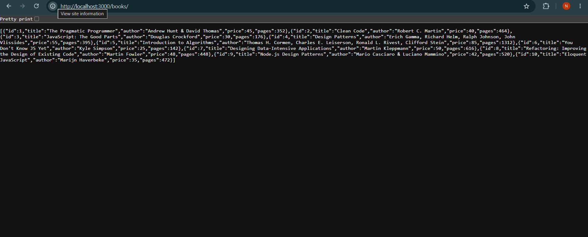
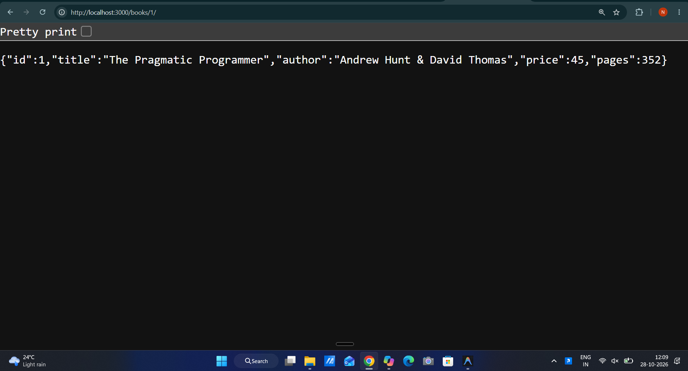
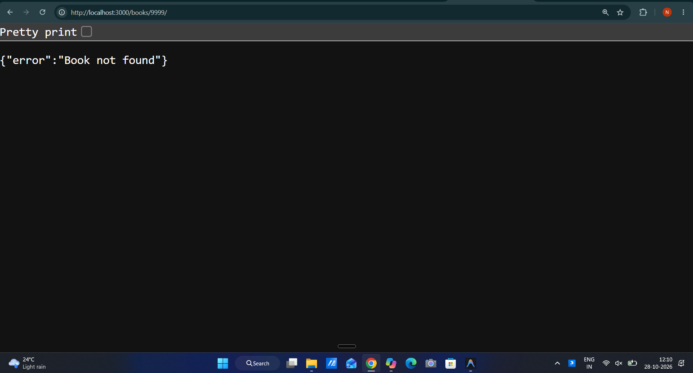
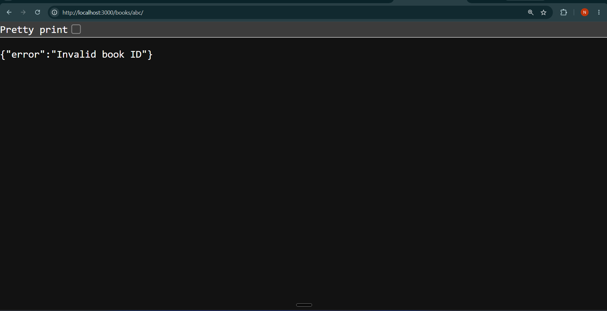
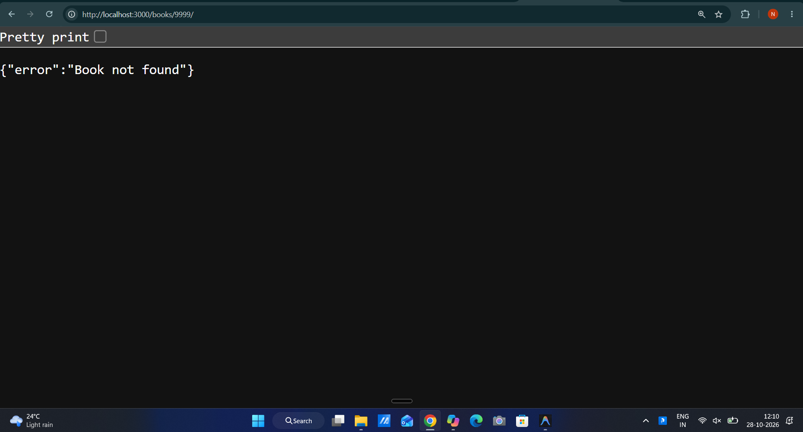
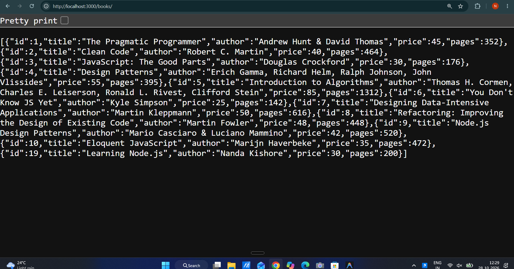
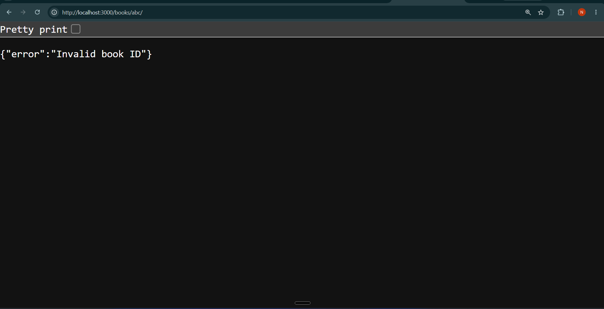
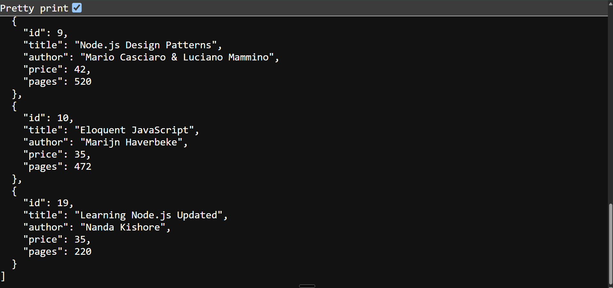
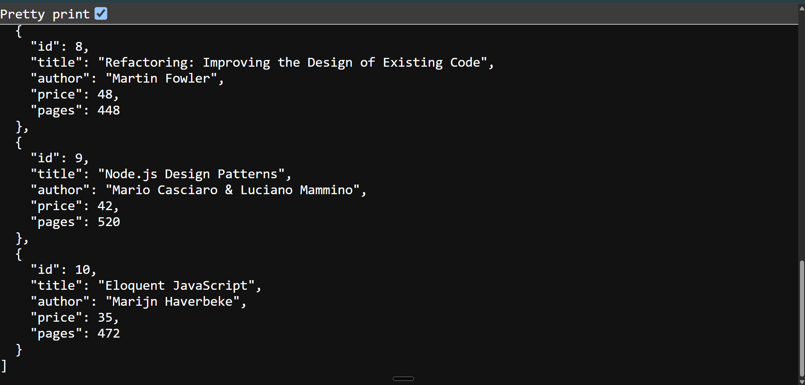

# Lab 3: REST API, Query Parameters, Validation, Debugging

## Student Details

- **Student Name:** JAI SAI
- **Registration Number:** 252U1R9172
- **Section:** CSE GEN AI (2C)
- **Course:** Backend Development Fundamentals
- **Academic Term:** Year II – Term II
- **Faculty:** Joel Prashanth D

---

## Live Link

- **Deployment Status:** Not applicable — Postman screenshots provided below.

---

## Objective

Turn the Lab 2 routes into a clean REST API with search, sorting, pagination, price filtering, input validation, correct HTTP status codes, and practise debugging common errors.

---

## Technologies Used

- Node.js
- Express.js
- SQLite (`sqlite` + `sqlite3`)
- JavaScript (CommonJS)
- npm
- Git and GitHub

---

## Project Structure

```text
lab-03/
├── server.js
├── package.json
├── README.md
├── .gitignore
└── screenshots/
    ├── 01-get-all-books.png
    ├── 02-search-filter.png
    ├── 03-price-range-filter.png
    ├── 04-sort-and-pagination.png
    ├── 05-get-single-book.png
    ├── 06-get-book-404.png
    ├── 07-post-create-book.png
    ├── 08-post-validation-error.png
    ├── 09-put-update-book.png
    ├── 10-delete-book.png
```

---

## Prerequisites

- Node.js and npm installed.
- Postman (for testing the API).
- Git installed for version control.

---

## Installation

```bash
npm install
```

---

## How to Run

```bash
npm start
```

Server starts at: [http://localhost:3000](http://localhost:3000)

---

## Endpoints

| Method | Path | Description | Status Codes |
|--------|------|-------------|--------------|
| GET | `/books` | Get all books (supports search, sort, pagination, price filter) | 200, 400 |
| GET | `/books/:id` | Get a single book by ID | 200, 400, 404 |
| POST | `/books` | Create a new book (validates title, author, price) | 201, 400 |
| PUT | `/books/:id` | Update an existing book by ID | 200, 400, 404 |
| DELETE | `/books/:id` | Delete a book by ID | 200, 400, 404 |

### Query Parameters for `GET /books`

| Parameter | Type | Default | Description |
|-----------|------|---------|-------------|
| `search_q` | string | `""` | Partial title match (LIKE) |
| `order_by` | string | `id` | Sort field: `id`, `title`, `author`, `price` |
| `order` | string | `ASC` | Sort direction: `ASC` or `DESC` |
| `limit` | number | `10` | Max results per page |
| `offset` | number | `0` | Number of records to skip |
| `min_price` | number | — | Filter books with price ≥ value |
| `max_price` | number | — | Filter books with price ≤ value |

### Example Requests

```
GET /books
GET /books?search_q=clean&order_by=price&order=ASC
GET /books?min_price=25&max_price=45&limit=5
GET /books?order_by=title&order=DESC&limit=3&offset=0
GET /books/1
POST /books         Body: { "title": "...", "author": "...", "price": 29.99 }
PUT /books/1        Body: { "price": 39.99 }
DELETE /books/1
```

---

## Screenshots

### 1. GET /books — All Books


### 2. GET /books?search_q=clean — Search Filter


### 3. GET /books?min_price=25&max_price=45 — Price Range Filter


### 4. GET /books?order_by=price&order=DESC&limit=3 — Sort & Pagination


### 5. GET /books/1 — Single Book


### 6. GET /books/999 — 404 Not Found


### 7. POST /books — Create Book (201)


### 8. POST /books — Validation Error (400)


### 9. PUT /books/:id — Update Book


### 10. DELETE /books/:id — Delete Book


---

## Problems Faced and Solutions

- **Port conflict (EADDRINUSE):** Another process was using port 3000. Fixed by killing the other process or changing PORT.
- **Wrong import path:** `require("./db")` pointed to a non-existent file. Fixed by correcting the path.
- **Table-name typo (no such table):** SQL query referenced `book` instead of `books`. Fixed by correcting the table name.
- **Missing await:** Async database call was not awaited, causing undefined result. Fixed by adding `await`.
- **SQL injection risk:** Replaced string-concatenated queries with parameterised queries using `?` placeholders.

---

## Security and Repository Practices

- Do not commit `.env` files or private credentials.
- Do not commit `node_modules/` or `*.db` files.
- Use parameterised queries — never concatenate user input into SQL strings.
- Use meaningful Git commit messages.
- Verify all HTTP status codes match the scenario (400 for bad input, 404 for missing record, 201 for create).

---

## GitHub Repository

[Backend Development Fundamentals — Lab 3](https://github.com/jaisai2070-create/Backend-Development-Fundamentals)

---

## Conclusion

This lab extends the Lab 2 books API with query parameters for search (`search_q`), sorting (`order_by`, `order`), pagination (`limit`, `offset`), and price filtering (`min_price`, `max_price`). Input validation on POST ensures that missing or invalid fields return a `400` with a clear JSON message. The debugging exercises reinforced how to fix common Node.js errors like port conflicts, bad import paths, table-name typos, and missing `await`.
